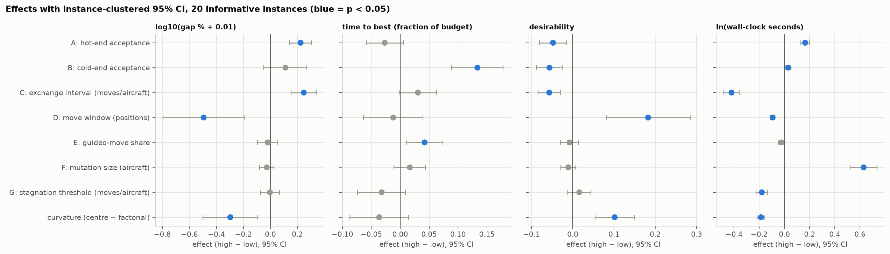
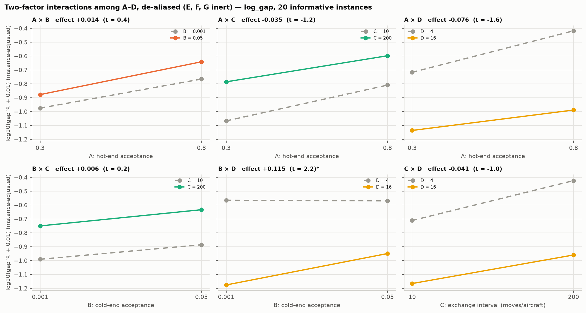
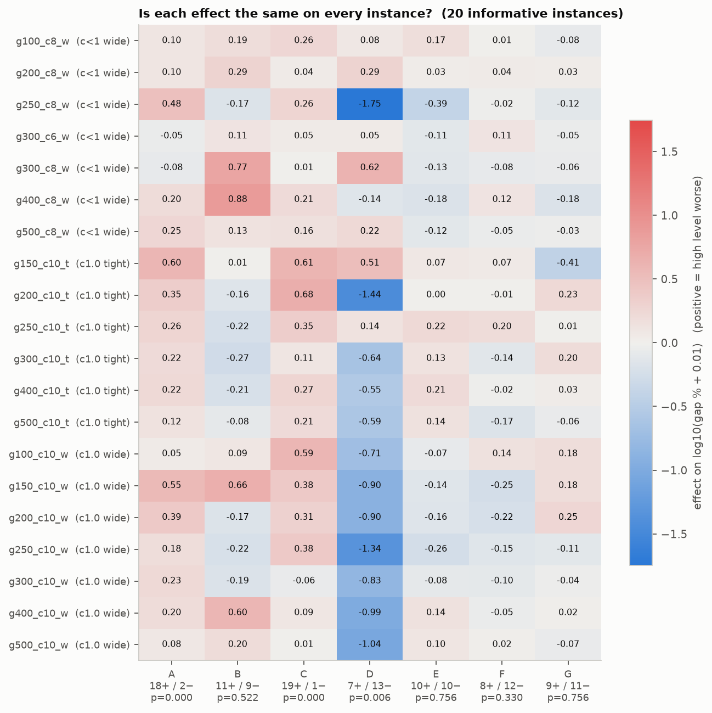
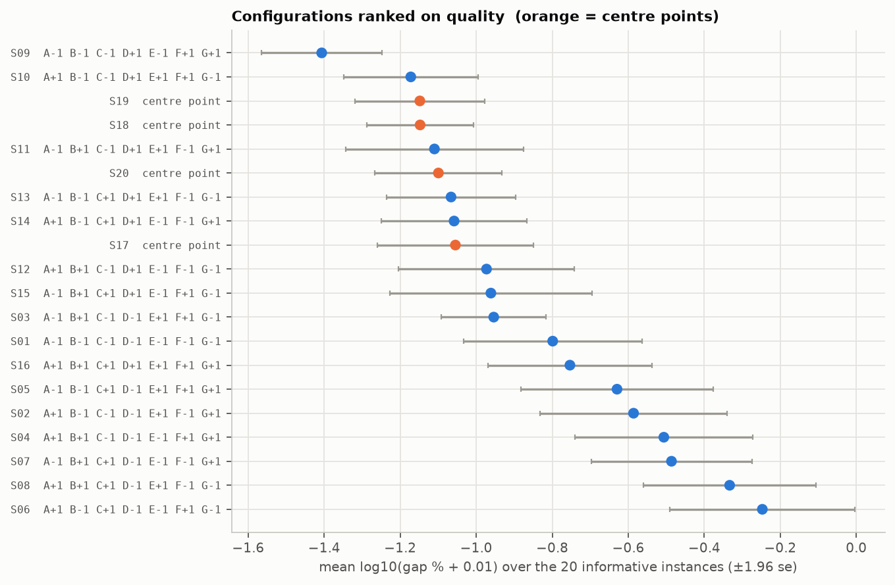
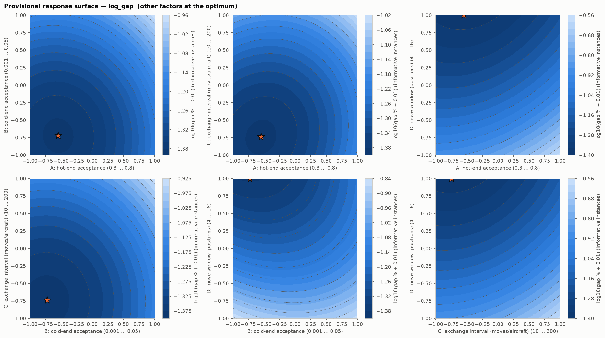
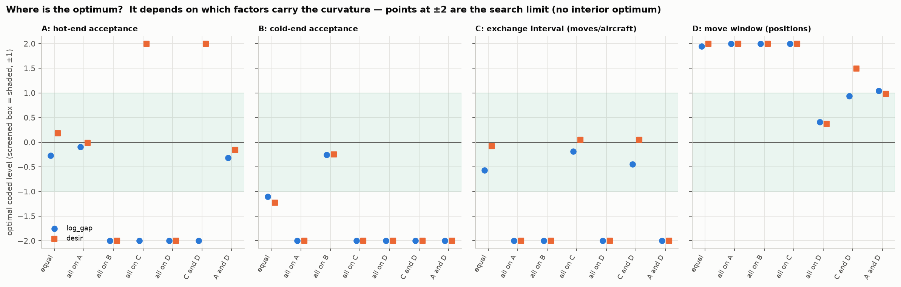

# Screening analysis: findings and the foldover / CCD decision

Analysis of `results/screening` (2^(7-3) resolution IV, 16 factorial + 4 centre
configurations, 48 `tune_large` instances, 3 seeds, 2880 runs). Produced by
`sa_single/doe/analyze.py` (standard screening plots, `plots/`) and
`sa_single/doe/screening_deep.py` (clustered inference, de-aliasing, surfaces,
cost; `deep/tables`, `deep/plots`). Both re-run from the repository root.

## 1. Bottom line

| Question | Answer |
|---|---|
| Which factors matter for final quality? | **A** hot acceptance (low better), **C** exchange interval (low better), **D** move window (high better; the largest effect). |
| Which factor matters for speed? | **B** cold acceptance (low = reaches its best sooner). B's effect on quality *reverses with window type* (section 5), so the pooled null on quality is misleading. |
| Which factors are inert on average? | **F** and **G** on quality and speed; **E** on quality. E acts on speed (+0.04, t 2.6) and flips sign with window type. |
| Is there curvature? | **Yes, strongly.** Centre points beat the factorial average (log gap −0.12 over all 48 instances, −0.30 over the 20 informative ones; better on 16 of 20 informative instances). A first-order model cannot place the optimum. |
| **Foldover needed?** | **No, not as the next step.** Main effects are clear of two-factor interactions, E/F/G are inert, so the 16 factorial runs already act as a full 2^4 in A–D. One aliased chain (AF = BG = DE) remains unresolved; adding E to the CCD resolves DE for 2 extra configurations, cheaper than a 25–33 h foldover (section 8). |
| **CCD needed?** | **Yes.** Face-centred, on **A, B, C, D, E**, with F and G fixed, and with the **window range extended to 8–24** (the optimum sits at or beyond the top of the screened range, section 7). 32 configurations. |

Two defects in `analyze.py` were fixed to get here (section 9). Nothing in the
SCREENING_REPORT headline numbers changes; D, C and A reproduce exactly.

## 2. Where the information is: 20 of the 48 instances

On **28 instances every one of the 60 runs** (20 configurations × 3 seeds) ends on the
same cost. The factors have exactly zero effect there, so all-48 effect sizes
are the informative-instance sizes scaled by 20/48 = 0.417 (A: 0.093 vs 0.223).
The 20 informative instances are the congested ones (c = 1.0: 13 instances; c = 0.8 wide: 6; c = 0.6 wide: 1; none with n = 50).

This also explains the report's "SA never improved on the start in 43.8% of runs":
1260 of those 1262 runs are on the flat instances, where the constructive start
is already the best known. On the informative instances the SA improved on the start in 99.8% of runs.
It also means **effect sizes below are on the instances where tuning matters**, and the 28 flat instances only add
cost to the next phase (about 30% of the runtime at 3 seeds: 45 h against 32 h for the recommended CCD, section 8).

Selecting these 20 uses the response variance, not the sign of any factor effect, but it is
still a data-driven choice, so both scopes are tabulated (`deep/tables/effects_clustered.csv`).

## 3. Main effects (instance-clustered inference)

Instances are the sampling units: regression with instance fixed effects and
standard errors clustered by instance (t on 19 df for 20 instances). The naive
per-run ANOVA in `analyze.py` pretends 2880 independent runs. Effect = mean(high) − mean(low).
Log gap: negative is better. Desirability and the ttb fraction are per `analyze.py`.

| Factor (low → high) | log gap, 20 inst. (t) | log gap, all 48 (t) | time to best, 20 inst. (t) | desirability, 20 inst. (t) | wall time, high vs low |
|---|---|---|---|---|---|
| A hot acceptance 0.30 → 0.80 | **+0.223 (5.5)** | +0.093 (4.0) | −0.027 (−1.6) | **−0.048 (−2.8)** | +18% |
| B cold acceptance 0.001 → 0.05 | +0.111 (1.4) | +0.046 (1.4) | **+0.133 (5.9)** | **−0.056 (−3.6)** | +3% |
| C exchange interval 10 → 200 /aircraft | **+0.246 (5.2)** | +0.103 (3.9) | +0.031 (1.9) | **−0.057 (−4.1)** | −34% |
| D window 4 → 16 | **−0.495 (−3.2)** | −0.206 (−2.8) | −0.012 (−0.5) | **+0.183 (3.5)** | −9% |
| E guide 0.50 → 0.95 | −0.021 (−0.5) | −0.009 (−0.6) | **+0.042 (2.6)** | −0.008 (−0.7) | −2% |
| F mutation size 4 → 16 | −0.027 (−1.0) | −0.011 (−1.0) | +0.016 (1.2) | −0.011 (−1.2) | **+88%** |
| G stagnation 100 → 1000 /aircraft | −0.004 (−0.1) | −0.002 (−0.1) | −0.032 (−1.5) | +0.016 (1.1) | **−16%** |
| curvature (centre − factorial) | **−0.297 (−2.9)** | −0.124 (−2.6) | −0.036 (−1.4) | **+0.101 (4.2)** | −17% |

(Bold: p < 0.05.) Reading it in practical terms: D high cuts (gap % + 0.01) by a factor ~3 on the
informative instances (10^0.495); A low and C low each by ~1.7.

Other views of the same effects: Pareto and half-normal charts (`plots/pareto_*.png`,
`plots/halfnormal_*.png`), main-effect plots (`plots/main_effects_*.png`).

**F is a cost, not a lever.** It has no quality or speed effect but the high level (mutation size 16) raises wall time
by 88%; the most expensive configurations (S03, S04, S10: 180–260 s per run against 55–110 s) all have F high with C low.
Wall time is from one machine with randomised run order, so the size is indicative; the direction (t = 11.6) is not in doubt.
**G high** is cheaper (−16%) with no quality penalty.

## 4. Interactions and aliasing

The factorial half is a 2^(7-3) with E = ABC, F = BCD, G = ACD. Because E, F, G are inert, its 16 runs
can be read as a **full 2^4 in A–D** (E, F, G contrasts are the three-factor interactions ABC, BCD, ACD).
The six A–D two-factor interactions are then estimable. Four-factor ABCD is the aliased chain AF = BG = DE.

| Contrast (log gap, 20 inst.) | effect | t |
|---|---|---|
| BD (=CF=EG) | +0.115 | 2.2 |
| **ABCD = AF = BG = DE** | **+0.095** | **4.3** (all 48: +0.040, t 3.5) |
| AD (=CG=EF) | −0.076 | −1.6 |
| CD (=AG=BF), AC (=BE=DG) | −0.041, −0.035 | −1.0, −1.2 |
| AB, BC | +0.014, +0.006 | < 0.5 |

- **BD is credible**: both parents are active, and the plot shows B only matters when the window is large
  (at D = 4 the line is flat). Low B with high D is best, consistent with both main effects.
- **ABCD = AF = BG = DE is the one open item.** A four-factor interaction is implausible, so it is one of A×F, B×G, D×E, and no parent pair has both factors
  active. Its size is 43% of the A main effect, the largest interaction contrast. By the sign pattern, the favourable side is
  A and F opposite, B and G opposite, or D and E opposite. The best screening configuration S09 (A −, B −, D +, E −, F +, G +) has the favourable sign on all three, so part of its lead may come from this chain.
- Practical consequence: with E, F, G fixed in the CCD, the chain only matters through *which levels* they are fixed at (section 8).

Also: `deep/plots/halfnormal_2to4_*.png`, `deep/plots/pareto_2to4_*.png`, `deep/tables/effects_2to4_dealiased.csv`, `plots/interactions_*.png` (the chain-labelled originals).

## 5. Effects depend on the instance class (control × noise)

- **A and C are consistent**: higher is worse on 18/20 and 19/20 instances (signed-rank p < 0.0001).
- **D is a congestion effect.** Mean D effect by group: c < 1 wide −0.09 (7 instances), c = 1.0 tight −0.43 (6), **c = 1.0 wide −0.96** (7).
  It is negative on 13 of 20 instances overall and on all 7 of c = 1.0 wide; two outliers (g250_c8_w −1.75, g200_c10_t −1.44) inflate the pooled mean, so use the median (−0.61) as the typical size.
  A large window does not hurt the lighter instances, so one setting can serve all.
- **B flips with window type**: effect −0.16 on tight windows, **+0.23 on wide** (interaction t 3.6, p 0.002).
  **E flips too**: +0.13 on tight, −0.09 on wide (t −4.1, p 0.001); on time to best, E × congestion t 4.5.
- **C shrinks with size**: +0.39 below n = 300, +0.11 at n ≥ 300 (t −4.1), still positive.

These are exploratory (42 control × noise tests; at p ≤ 0.002 about 0.1 would arise by chance, 4 were seen, so they are probably real, but the sizes are not
precise). `deep/tables/control_x_noise.csv`, `deep/plots/effects_by_instance_group.png`.

Consequences for the CCD: model the surface **per instance class** (at least D × congestion, B and E × window type, C × size) rather than one pooled surface. Keep the tight-window
instances: there are only 6 informative ones, all c = 1.0.

## 6. Curvature and the configurations

The four centre points rank 3, 4, 6 and 9 of 20 on quality and 4, 5, 7, 8 on desirability, ahead of 11 of the 16 corners, although they
sit in the middle of every factor. Only the best corner S09 clearly beats them (S10 ties; mean gap 0.26% vs ~0.5% at the centre; the worst corner S06 2.7%). That is the signature of an interior optimum in at least some of A–D.

`deep/tables/configuration_ranking_informative.csv`, `deep/plots/curvature_by_instance.png`.

## 7. Provisional response surfaces, and why the box must move

Screening has one curvature degree of freedom (centre vs corners), so the pure quadratic terms of A–D cannot be separated.
The surfaces below fit the A–D main effects, all six interactions and **one pooled curvature coefficient shared equally across A–D** (q = 0.074 ± 0.026 on log gap),
with instance fixed effects, on the informative instances. Treat them as **provisional pictures of the screened region, not as a model to optimise on**.
Equal sharing is an assumption.

(Also `deep/plots/surfaces_*.png` for 3-D views, `contours_*`, `perturbation_*` for log gap, time to best, desirability.)

Because the split is unknown, the sensitivity of the optimum was mapped over seven splits (equal, all on one factor, C+D, A+D):

- **D**: the optimum is at or near the top of the screened range (coded ≥ +0.9) or beyond it in 6 of 7 splits for both responses (equal split: coded +1.9, window ≈ 22). Only if D alone carries all the curvature does it fall clearly inside (+0.4, window ≈ 12).
  **The window range 4–16 does not bracket the optimum; extend it.**
- **A and C**: interior (A coded −0.1 to −0.55, A ≈ 0.41–0.53; C coded −0.2 to −0.6, ≈ 19–33 moves/aircraft) when they carry some of the curvature, otherwise at or beyond the low edge. The screened box is a reasonable CCD range for them.
- **B**: at the low edge for most splits; B = 0.001 is near-greedy at the cold end, so there is little room below it. Keep the range; expect an edge optimum for speed.

So the CCD cannot simply reuse the screened box: it needs a shifted, wider window range, and it must fit the full quadratic model that screening could not.

## 8. Foldover or CCD?

**Foldover.** Its job is to separate aliased two-factor interactions. Here that job is mostly done by the
inert E/F/G, leaving one chain. A single-factor foldover (16 configurations) clears only the two-factor interactions of one factor: on E it separates DE from AF = BG
(which stay aliased); on F it separates AF; on G, BG. Resolving all three takes two folds.
Cost: 960 runs, ~25 h on the 20 informative instances (2304 runs, ~33 h on all 48). It does nothing about curvature.

**CCD.** Needed because curvature is significant and the optimum is not located. A face-centred design on A, B, C, D and **E** costs 32 configurations
(16 half-fraction corners with E = ABCD, resolution V, + 10 axial + 6 centre) against 30 for four factors.
E is worth the extra two: its D × E interaction is one of the three candidates for the chain, it acts on speed, and its effect reverses with window type.
In a resolution V corner set every two-factor interaction of A–E is clear of the others, so DE is resolved directly.

| Design | Configs | Runs, 20 inst. × 3 seeds | Hours (est.) | 2 seeds |
|---|---|---|---|---|
| Single-factor foldover | 16 | 960 | 25 | 17 h |
| CCD A–D (E, F, G fixed) | 30 | 1800 | 30 | 20 h |
| **CCD A–E (F, G fixed)** | **32** | **1920** | **32** | **21 h** |
| F and G check at the CCD optimum | 3 | 180 | 5 | 3 h |

Run on all 48 instances the CCD A–E is 4608 runs, ~45 h (foldover ~33 h). Hours use the screening wall time per run (59 s with F low, 94 s when F varies) and so are estimates.

### Recommended next phase

- Face-centred CCD on **A, B, C, D, E**, 6 centre points; the file `deep/tables/ccd_proposed_design.csv` lists coded and natural levels.
- **Ranges:** A 0.30–0.80, B 0.001–0.05, C 10–200, E 0.50–0.95 as screened; **D window 8–24 (centre 16)**.
- **Fixed:** F = 4 (no quality effect, 88% cheaper than F = 16), G = 1000 per aircraft (cheaper, faster, and the favourable side of BG when B is low), E varied.
  Caveat: if the open chain is A × F, low F with low A is its unfavourable side (about 0.05 log-gap units, the price of the time saving; the F check below tests exactly this).
  Alternative: F = 10 (centre) removes AF from the A–D surface at +37% time.
- **Instances:** the 20 informative ones, 3 seeds (2 if time presses). Check that the 28 flat ones stay flat at the optimum in the confirmation phase.
- **Analysis:** per-instance-class surfaces as in section 5, instance fixed effects, lack-of-fit against pure error from the centre replicates.
- **Then:** the 3-configuration F/G check at the optimum (F → 10 or 16, G → 100), then confirmation on `holdout_large`. If the check shows F or G matters, do a short local re-optimisation rather than a foldover.
- **Reference values:** the gap is measured against the best cost found in these runs. Anchor runs (10× budget, `run_doe.py` PHASE = anchor) on the 20 informative instances before or alongside the CCD would harden that reference; the best configurations' gap near 0.1% is partly a floor of this reference.

Budget note: on the informative instances 14.6% of runs have their best after 90% of the budget (2.3% after 99%), so the 5000 moves per aircraft is slightly limiting on the hardest instances; the later budget phase should look at it.

## 9. Corrections, caveats and open items

- **`analyze.py`, fixed:** (1) the desirability response was stored in column `D`, overwriting the coded factor D, so D's effect was NaN and every interaction with D wrong in `analyze.py`'s own tables (the response is now `desir`); (2) the model term `C(instance)` collided with factor column `C` in patsy (now `instance`). It also stops on a Windows console encoding error at the last print line unless `PYTHONIOENCODING=utf-8` is set (files are written before that).
- **`analyze.py`, not changed:** its active-factor rule (any p < 0.05 or beyond Lenth ME on log gap or desirability, naive error) flags **all seven** factors, which contradicts the clustered result; do not take `CCD_FACTORS` from its last line. It also pools all 48 instances, which dilutes everything by 20/48.
- **Harness mismatch:** the committed `run_doe.py` and `instances.py` read the 24-instance `tune` set and have no instance filter; the screening results come from `tune_large` (48 instances) and no committed code references it. The next phase needs the `tune_large` selection and a filter for the 20 informative instances.
- **Parameter changes:** the window range 8–24 requires editing the factor D bounds in `sa_single/params.py` (currently 4–16) before the CCD; screening and CCD data then use different coding for D and should not be pooled.
- **Residuals:** log gap is zero-inflated (median gap 0, floor −2), so classical residual assumptions fail (`plots/residuals_*.png`); the clustered inference and the per-instance sign counts (section 5) are the safeguards.
- The surfaces and the optimum sensitivity rest on an assumption about how curvature is shared and should not be used to pick final parameters.

## 10. File index

`results/analysis_screening/`
- `plots/` (analyze.py): Pareto, half-normal, main-effect, interaction, by-class, curvature, residual, convergence and trade-off plots per response.
- `deep/plots/`: `effects_forest`, `effect_consistency_by_instance`, `effects_by_instance_group`, `interactions_AD_{log_gap,desir}`, `halfnormal_2to4_*`, `pareto_2to4_*`, `curvature_by_instance`, `configuration_ranking`, `contours_*`, `surfaces_*`, `perturbation_*`, `optimum_sensitivity`.
- `deep/tables/`: `effects_clustered`, `effects_2to4_dealiased`, `instance_level_effects_log_gap`, `instance_consistency_log_gap`, `effects_by_instance_group_log_gap`, `control_x_noise`, `curvature_by_instance`, `configuration_ranking_informative`, `surface_models.json`, `optimum_sensitivity`, `next_phase_cost`, `ccd_proposed_design`.
